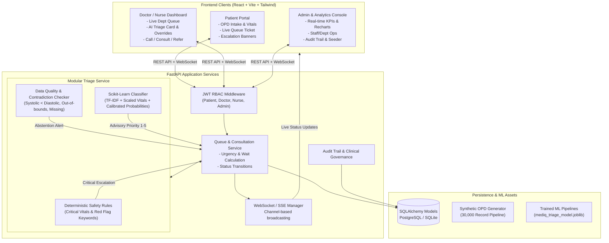
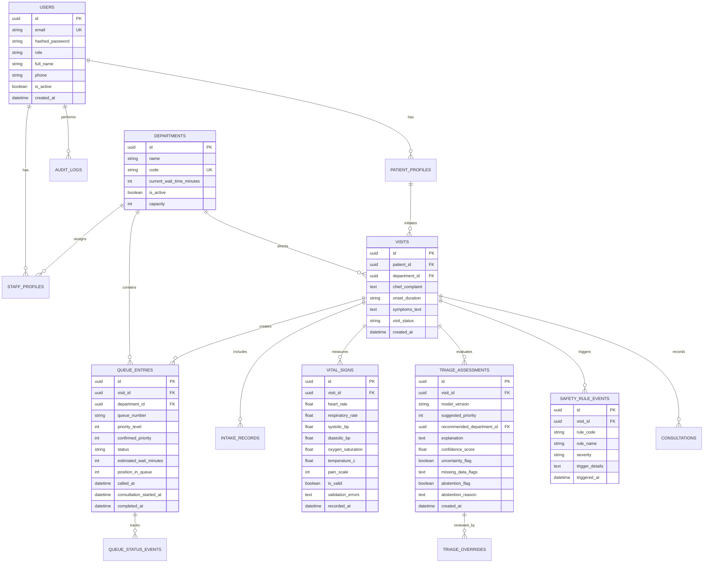

# MEDIQ AI — Intelligent OPD Triage and Queue Management System
## Architecture & Engineering Implementation Plan

### 1. Executive Summary & Clinical Governance
**MEDIQ AI** is an intelligent, safety-first Outpatient Department (OPD) Triage and Queue Management System designed to eliminate chaotic patient crowding, streamline clinical workflows, and catch life-threatening emergencies immediately upon arrival at high-volume healthcare facilities.

> [!IMPORTANT]
> **Clinical Safety Notice**: MEDIQ AI is a **clinical decision-support prototype**, not an autonomous diagnostic system. All AI recommendations are advisory and must be reviewed by qualified clinicians. Deterministic safety rules always override AI predictions.

---

### 2. High-Level System Architecture

---

### 3. Database Entity Relationship Model

---

### 4. Priority Categorization Scheme (Clinical Urgency Levels 1–5)

| Urgency Level | Category | Clinical Description | Maximum Safe Target Wait | Color Badge |
|---|---|---|---|---|
| **Priority 1** | **Resuscitation** | Immediate life threat; airway, breathing, severe shock, or cardiac arrest | **Immediate (0 min)** | Red (`#DC2626`) |
| **Priority 2** | **Emergent** | High risk, severe chest pain, respiratory distress, acute altered mental state | **< 15 minutes** | Orange (`#EA580C`) |
| **Priority 3** | **Urgent** | Moderate distress, 2+ system complaints, stable vitals requiring rapid workup | **< 30 minutes** | Yellow (`#CA8A04`) |
| **Priority 4** | **Less Urgent** | Low risk, stable chronic conditions, mild symptoms, single uncomplicated issue | **< 60 minutes** | Green (`#16A34A`) |
| **Priority 5** | **Non-Urgent** | Routine medication renewal, minor wound review, suture removal, preventative | **< 120 minutes** | Blue (`#2563EB`) |

---

### 5. Deterministic Safety-Rule Layer & Abstention Logic

The safety rules execute **before** ML inference and have statutory authority over model predictions:

1. **Vital Sign Extreme Thresholds**:
   - `CRIT_O2`: $SpO_2 < 85\%$ $\rightarrow$ Priority 1 (Resuscitation)
   - `CRIT_SBP_LOW`: $Systolic\ BP < 70\ mmHg$ $\rightarrow$ Priority 1 (Septic/Cardiogenic Shock)
   - `CRIT_SBP_HIGH`: $Systolic\ BP > 220\ mmHg$ or $Diastolic\ BP > 120\ mmHg$ $\rightarrow$ Priority 1 (Hypertensive Crisis)
   - `CRIT_HR`: $HR < 40\ bpm$ or $HR > 160\ bpm$ $\rightarrow$ Priority 1
   - `CRIT_RR`: $RR < 8\ bpm$ or $RR > 35\ bpm$ $\rightarrow$ Priority 1
   - `CRIT_TEMP`: $Temp > 41.5^\circ C$ or $< 34^\circ C$ $\rightarrow$ Priority 1

2. **Severe Red Flag Lexicon**:
   - Keywords: `"crushing chest pain"`, `"radiating to arm"`, `"anaphylaxis"`, `"stridor"`, `"unresponsive"`, `"sudden facial droop"`, `"thunderclap headache"`, `"massive hemoptysis"`.
   - Triggers automatic Priority 1 or 2 escalation.

3. **Data Quality & Abstention Engine**:
   - **Contradiction**: $Systolic\ BP \le Diastolic\ BP$ or $SpO_2 > 100\%$ or $HR \le 0$.
   - **Missing Critical Data**: Severe chest pain or acute breathlessness with NO vitals provided.
   - **Abstention Decision**: Returns `abstention_flag = True`, status `"Cannot assess safely — immediate nurse/clinical review required"`, prevents misleading model score, escalates to triage nurse desk immediately.

4. **Asymmetric ML Evaluation Cost**:
   - In synthetic training and evaluation, an under-triage error for a true emergency (e.g. predicting P3/P4 for a P1/P2 patient) is penalized with a **$20\times$ loss weight** relative to an over-triage error.

---

### 6. Step-by-Step Implementation Roadmap

- [x] **Phase 1: Environment & Architecture Plan** (Workspace analysis, git initialization, setup plan)
- [x] **Phase 2: Database Models, Alembic Migrations, & Core Config** (14 normalized SQLAlchemy models, Alembic migrations applied, JWT RBAC security)
- [x] **Phase 3: Modular Triage Service & Synthetic ML Pipeline** (Deterministic safety rules, contradiction detector, 10,000+ synthetic cohort, scikit-learn training, asymmetric 20x cost evaluation)
- [x] **Phase 4: Backend REST APIs & WebSocket Real-time Manager** (Auth, visits, queue management, clinician overrides, audit trails, analytics, channel-isolated WebSockets)
- [x] **Phase 5: Frontend Development (React + Tailwind + Lucide + Recharts)** (Patient Portal, Doctor/Nurse Clinical Dashboard, Admin Console, Public Kiosk)
- [x] **Phase 6: Comprehensive Automated Testing** (Pytest suite testing auth, RBAC, safety rules, triage inference, queue transitions, overrides, audit logs with 100% pass rate)
- [x] **Phase 7: End-to-End Live Demonstration & Verification** (13/13 acceptance criteria verified live via verify_live_e2e.py)
- [x] **Phase 8: Documentation & Repository Finalization** (Prinstine Git commit, master README.md, .env.example, architecture Mermaid diagrams)
